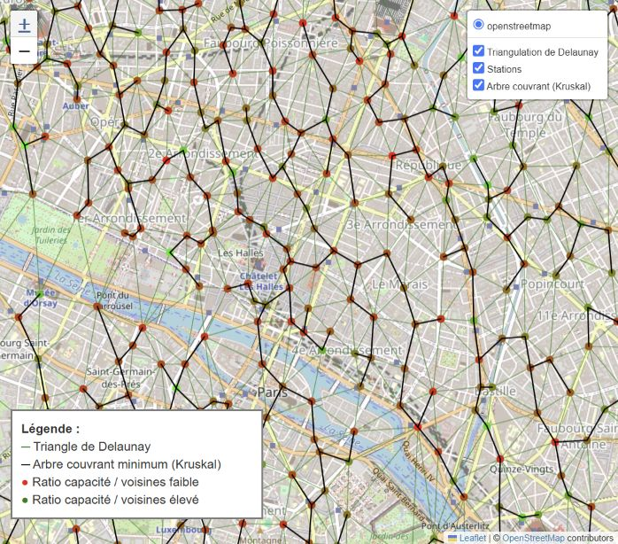

# Vélib’ · Explorer les stations et modéliser leur raccordement

Ce projet utilise les données des stations Vélib’ de Paris et des communes voisines pour visualiser leur répartition, leurs capacités et leurs liens de voisinage. Les cartes interactives permettent aussi d’explorer un scénario de raccordement électrique des stations à l’aide d’un arbre couvrant minimum.

## Aperçus du projet

### Réseau de stations

Les points représentent les stations et les lignes vertes leurs voisinages obtenus par triangulation de Delaunay. Les couleurs des stations correspondent au rapport entre leur capacité et leur nombre de voisines.

### Arbre couvrant minimum

Les liaisons noires relient les stations sans former de cycle. Elles sont sélectionnées avec l’algorithme de Kruskal pour étudier le scénario de raccordement du réseau.

### Zones de proximité

Chaque cellule de Voronoï représente une zone de proximité autour d’une station. Les calques permettent de la comparer avec les stations, les triangles de Delaunay et l’arbre couvrant.

## Lancer en local

[Télécharger le dépôt](https://github.com/Kajan94/Projet-Velib/archive/refs/heads/main.zip), le décompresser, puis ouvrir le dossier contenant `README.md`, les scripts Python et les fichiers JSON.

### Consulter les cartes

Les cartes déjà générées s’ouvrent directement dans le navigateur :

- [Carte du réseau et arbre couvrant](https://kajan94.github.io/Projet-Velib/velib_stations_map.html).
- [Carte des zones de Voronoï](https://kajan94.github.io/Projet-Velib/velib_stations_voronoi.html).

Après téléchargement, ouvrir les fichiers `velib_stations_map.html` et `velib_stations_voronoi.html` pour les consulter localement. Une connexion Internet charge le fond de carte et les bibliothèques JavaScript.

## Fonctionnalités

- **Navigation sur les cartes** : zoomer sur une zone et activer ou masquer les calques pour comparer les représentations du réseau.
- **Analyse des voisinages** : relier les stations à partir de leurs coordonnées et consulter leurs connexions géométriques.
- **Scénario de raccordement** : afficher un arbre couvrant minimum reliant les stations du modèle avec un ensemble de liaisons sans cycle.
- **Zones de proximité** : visualiser les cellules de Voronoï associées aux stations. Les cellules non bornées ne sont pas affichées.

L’arbre est pondéré par les distances géométriques entre les coordonnées des stations. Les couleurs représentent un rapport entre capacité et nombre de voisines ; elles ne mesurent pas la fréquentation réelle.

### Préparer les données

Les fichiers JSON nécessaires aux cartes sont déjà inclus. Pour les reconstruire depuis l’instantané source :

~~~sh
python code.py
python coordonnés.py
~~~

Le premier script extrait les identifiants, noms, capacités et coordonnées des stations. Le second conserve les identifiants et coordonnées utilisés pour les calculs géométriques.

## Organisation du code

| Chemin | Rôle |
| --- | --- |
| `station_information.json` | Instantané source des informations des stations Vélib’. |
| `code.py` et `coordonnés.py` | Extraction des informations utiles et des coordonnées depuis l’instantané source. |
| `velib_stations.json` et `velib_coordonnées.json` | Données préparées pour les calculs et la génération des cartes. |
| `carte.py` | Génération de la carte de Delaunay et de l’arbre couvrant minimum. |
| `carte_voronoi` | Génération de la carte des cellules de Voronoï et des calques du réseau. |
| `velib_stations_map.html` et `velib_stations_voronoi.html` | Cartes générées, consultables directement dans le navigateur. |
| `docs/` | Aperçus des cartes et de l’arbre couvrant. |

Source de l’instantané du 20 janvier 2025 : [données ouvertes Vélib’ Métropole](https://www.data.gouv.fr/datasets/velib-localisation-et-caracteristique-des-stations). 

[Projet dans le portfolio](https://kajan94.github.io/Portefolio/#velib)

## Travail en équipe

Projet universitaire réalisé à quatre en **première année de BUT Informatique** à l’IUT de Créteil-Vitry (UPEC), avec **Kajan Arulnathan, Alexandre Chenal, Ariles Dadi et Léo Vang**.

Le travail a porté sur la préparation des données, la modélisation du réseau, les cartes interactives et le scénario de raccordement électrique. Le suivi des tâches et des échéances s’appuyait sur un tableau Kanban et un diagramme de Gantt dans GitHub.
